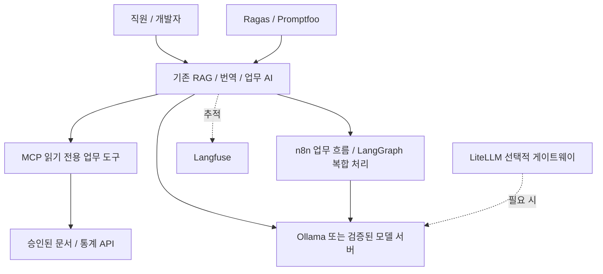

# 단계별 도입 순서

한 단계씩. 기간은 예상이 아니라 실제 기록으로 관리한다. 아래 단계들은 각 단계의 격리 검증 기준이며 운영 적용은 별도 승인·측정이 필요하다.

| ID | 도구/역량 | 첫 실무 적용 | 지속 효과 | 필수/조건부 |
|---|---|---|---|---|
| AX-00 | 사전 점검 | RAG, 기존 평가/서버/보안 | 안전한 비교 기준 | 필수 |
| AX-01 | Langfuse | RAG 요청 추적 | AI 운영 관측 | 필수 (자원 부족 시 BLOCKED) |
| AX-02 | Ragas | RAG 독립 평가 | 품질 변화 측정 | 필수 |
| AX-03 | Promptfoo | RAG·도구 보안/회귀 | 변경 전 반복 검증 | 필수 |
| AX-04 | MCP 서버 | 읽기 전용 사내 지식·상태 | 여러 AI의 공통 도구 사용 | 필수 |
| AX-05 | Tool Calling + 구조화 출력 | 읽기 전용 업무 통계 | 정확한 수치와 출처를 갖춘 답변 | 필수 |
| AX-06 | n8n | 주간 개발·운영 보고 초안 | 반복 보고 준비 업무 감소 | 필수 |
| AX-07 | LangGraph | 보고 검토·수정·재개 | 복합 업무의 안전한 상태 관리 | 필수 |
| AX-08 | LiteLLM | 공통 모델 라우팅 | 모델 접근·한도·추적 | 조건부 |
| AX-09 | vLLM | Ollama와 격리 성능 비교 | 동시 요청 대응 | 조건부 |
| AX-10 | pgvector | Qdrant와 동일 코퍼스 비교 | 데이터 저장 기술 선택 역량 | 조건부 |

실행 지침은 `docs/stages/AX-xx-*.md`에 있다. AX-04와 AX-05는 구분된 단계: MCP 프로토콜 경험과 LLM의 도구 호출 검증을 각각 확보한다. AX-06과 AX-07은 기존 업무 흐름을 재사용하되 불필요한 이중 오케스트레이션을 만들지 않는다. LangGraph는 n8n이 호출하는 독립 복합 처리 서비스로만 검토하거나 독립 시연으로 비교한다.

## 단계별 의존성 / 승인
- AX-00에서 기준값·자원·허용 데이터·접근권한·테스트 환경 확인. 격리 배포 가능 여부와 승인 범위를 먼저 기록한다.
- AX-01~03: 기존 RAG 기능과 정책 유지. 평가/보안 작업은 실제 고객 자료가 아닌 승인된 샘플과 독립 평가 세트로 시작한다. 기존 검색 목표 미달은 별도 개선 작업으로 분리한다.
- AX-04~05: 권한/인증 부재로 다중 사용자 운영 배포 금지. 실제 운영 통계 사용 승인이 없다면 합성 API를 사용하고 상태를 명시한다.
- AX-06~07: 사내 보고서 초안만 우선. 발송·외부 공유·현장 조치 자동화 금지. 실제 업무 담당자 확인과 반복 처리 증거 확보.
- AX-08~10: 필요성, 자원, 실험 결과로 운영 채택/보류 결정. 이전 기술을 대체할 이유가 없다면 비교 결과만 기록하고 현행 유지한다. 보류 시 승인 기록 필요.

## 최종 목표 구조 (구축 강제 아님)

AI 시스템마다 필요한 컴포넌트만 연결한다. Qdrant 유지가 기본이다. 기존 Sentry/PostHog을 Langfuse로 대체하지 않는다.
